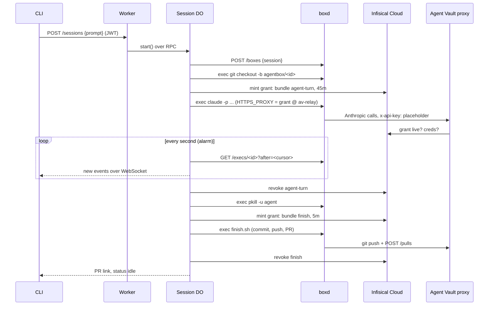

# agentbox cloud: Architecture

The production-style version of [agentbox](../local/ARCHITECTURE.md). You run `agentbox run "task"` from any laptop. A **Cloudflare Durable Object** takes charge of the session, a sandbox on a **DigitalOcean droplet** that already contains the Infisical repo does the work with Claude Code, and the change comes back as a PR. The agent never holds a real credential: every call it makes (Anthropic, GitHub) goes through the **Infisical Agent Vault proxy**, which attaches the credential after the request has left the sandbox.

> **Status (2026-09-26):** Running end to end. Verified: a box can't resolve or reach anything outside its network; through the proxy, httpbin receives the real secret while the box sends a placeholder, and a non-bundle host gets a 403; a full `agentbox run` from a laptop created a box from the repo image, minted an `agent-turn` grant, ran Claude, then pushed and opened [PR #1](https://github.com/jakehulberg2/infisical2/pull/1) under a separate `finish` grant; a follow-up resumed in the same box with Claude's history and updated the same PR. Both grants were revoked after each step. First session: 2 turns, $0.18. Canvas: [architecture.excalidraw](architecture.excalidraw).

## 1. The big picture

```mermaid
flowchart LR
    subgraph Laptop["Any engineer's laptop"]
        CLI["agentbox CLI"]
    end

    subgraph CF["Cloudflare"]
        W["API Worker<br/>agentbox-api.example.workers.dev"]
        DO["Session Durable Object<br/>one per session, own SQLite"]
        D1[("D1: sessions_index")]
    end

    subgraph DO_VPC["DigitalOcean VPC agentbox · 10.60.0.0/20 · nyc3"]
        subgraph SBX["agentbox-sandbox · 203.0.113.10 / 10.60.0.3"]
            CFD["cloudflared<br/>(outbound tunnel)"] --> Boxd["boxd 127.0.0.1:8788<br/>box API"]
            subgraph agentnet["agentnet 172.30.0.0/24 (internal)"]
                Box["box per session<br/>agentbox/infisical2 image"]
                Relay["av-relay .2"]
            end
        end
        subgraph PX["agentbox-proxy · 10.60.0.2"]
            P["Agent Vault proxy<br/>do-proxy :17323"]
        end
    end

    Inf["Infisical Cloud<br/>app.infisical.com<br/>Agent Vault"]
    A["api.anthropic.com"]
    GH["github.com · api.github.com"]

    CLI -- "HTTPS + WebSocket<br/>agentbox JWT" --> W --> DO
    DO --> D1
    DO -- "create / exec / read output<br/>boxd.example.com<br/>Access service token + BOXD_TOKEN" --> Tun["Cloudflare Tunnel<br/>+ Access"]
    Tun --> CFD
    DO -- "mint / revoke grants<br/>machine identity" --> Inf
    Boxd -- "docker exec" --> Box
    Box -- "HTTPS_PROXY" --> Relay -- "VPC only" --> P
    P -- "check grant, get creds" --> Inf
    P -- "real key / token attached" --> A & GH
```



| Piece | Runs on | Replaces (agentbox on the minis) | Plays the role of (Ramp) |
|---|---|---|---|
| CLI | Engineer laptops | `bin/agentbox` | Web UI, Slack bot |
| API Worker | Cloudflare Workers | `server.mjs` | Cloudflare Worker |
| Session Durable Object | Cloudflare, one per session | `runner.mjs` + SQLite | Durable Object per session |
| D1 `sessions_index` | Cloudflare | `GET /sessions` query | |
| boxd (box API) | Sandbox droplet, reached only through a Cloudflare Tunnel + Access | `pool.mjs` | Modal's sandbox API |
| Boxes | Docker on the sandbox droplet | Colima boxes | Modal sandboxes |
| Repo image | Built on the droplet every 30 min | golden image + git mirror | Modal image rebuilt every 30 min |
| Agent Vault proxy | Proxy droplet, VPC-only | mini3 proxy | (no broker) |
| Agent Vault | Infisical Cloud | self-hosted Infisical on mini3 | |

## 2. One turn, end to end



The agent's grant (`agent-turn`) can call the model and nothing else. After Claude exits and its processes are killed, the DO runs `finish.sh` (a script stored in the Worker, not in the box) under a second grant (`finish`) that can push and open a PR. So "the agent can't push" holds even though git now runs inside the box.

## 3. Sessions and state

| State | Box | Agent Vault | Next message |
|---|---|---|---|
| `queued` / `starting` | Being created or woken | Being minted | Queued in DO SQLite |
| `running` | Claude working | `agent-turn` live | Queued |
| `finishing` | `finish.sh` running | `finish` live | Queued |
| `idle` | Running, nothing in it | None | Runs immediately |
| `sleeping` | **Stopped** after 5 idle min; disk kept (repo, commits, `~/.claude`) | None | DO starts it (seconds), Claude `--resume`s |
| `failed` / `cancelled` | Deleted | None | New session |

Everything the DO does happens in its **alarm**, one step at a time, with a cursor into the command's output. If the DO is evicted mid-turn, the next alarm reads from the cursor and carries on; the command on the droplet never noticed. Details: [docs/api-and-durable-objects.md](docs/api-and-durable-objects.md), [docs/state.md](docs/state.md).

## 4. The sandbox droplet

Boxes are Docker containers from `agentbox/infisical2:<sha>`: the agentbox golden image (Node 22, git, Claude Code, the proxy's CA, non-root `agent` user) plus the Infisical fork at `/workspace` with backend and frontend `npm ci` already run. 10.6 GB, shared read-only by every box; each box only stores what it changes. A cron job rebuilds it every 30 min from the fork's `main`. Details: [docs/sandbox-host.md](docs/sandbox-host.md).

## 5. Networking: the only way out

Same rule as agentbox: a box has no route anywhere except the proxy. And the droplets have **no public inbound ports** except SSH from one IP: the DO reaches boxd through a Cloudflare Tunnel that `cloudflared` opens *outbound*, guarded by Cloudflare Access.

| Layer | What |
|---|---|
| `agentnet` | Docker `--internal` network. No gateway, and Docker's DNS won't resolve outside names |
| `av-relay` | socat on `agentnet` + bridge, forwarding only `:17323` to `10.60.0.2:17323` |
| VPC | The relay reaches the proxy droplet over DigitalOcean's private network |
| Proxy firewall | `17323` open only to `10.60.0.0/20`; closed to the internet |
| Proxy policy | Access bundle hosts only; anything else gets 403 |
| boxd ingress | `boxd.example.com` → Cloudflare Access (service token only) → Tunnel → `cloudflared` → `127.0.0.1:8788`. Without the token, Cloudflare returns 403 and the request never reaches the droplet |
| Sandbox firewall | Inbound: SSH from your IP only. Nothing listens publicly |

Details: [docs/networking.md](docs/networking.md).

## 6. Credentials: who holds what

| Secret | Lives in | Enters a box? |
|---|---|---|
| Anthropic API key | Agent Vault service `anthropic` (bundle `agent-turn`) | No |
| GitHub bot token | Agent Vault bundle `finish`: the GitHub template service (Bearer, api.github.com) and `github-git` (Basic, github.com) | No |
| Agent Vault grant token | Minted per step, revoked right after | Yes, as proxy auth; useless outside the proxy |
| Infisical machine identity `agentbox-cloud` | Worker secret | No |
| `BOXD_TOKEN` | Worker secret + `/etc/agentbox/boxd.env` on the droplet | No |
| Access service token `agentbox-worker` (`CF_ACCESS_CLIENT_ID` / `SECRET`) | Worker secrets; issued by the Cloudflare account that owns example.com | No |
| Tunnel token | `/etc/agentbox/cloudflared.env` on the droplet | No |
| `JWT_SECRET` | Worker secret | No |
| User JWT (24 h) | `~/.config/agentbox/credentials` (0600) | No |
| Setup keys (Cloudflare, GitHub, DigitalOcean) | Your Infisical project, never in files | No |

Details: [docs/agent-vault.md](docs/agent-vault.md), [docs/security.md](docs/security.md).

## 7. What changed from agentbox, and from the first design

| agentbox (minis) | First cloud design | As built | Why |
|---|---|---|---|
| Orchestrator process + one SQLite | Worker + DO per session | Same | |
| SSE | WebSocket to the DO | Same (hibernation API) | |
| Shared `ORCH_API_TOKEN` | GitHub device login → JWT | Same | |
| Colima boxes + warm pool | Daytona sandboxes | Docker on a DigitalOcean droplet, no pool | Daytona Tier 1 can't restrict egress to our proxy or reach arbitrary IPs |
| Host git mirror + golden image | Daytona snapshot with repo | Docker image with repo + deps, rebuilt every 30 min on the droplet | Same idea, our host |
| agentnet + socat relay | Daytona allowlist + stunnel + NLB | agentnet + relay + VPC | Box and proxy share a private network, so no TLS hop or public proxy |
| Host-side push with `GITHUB_TOKEN` | `finish.sh` under a `finish` grant | Same | |
| Self-hosted Infisical on mini3 | Self-hosted on AWS | Infisical Cloud | Agent Vault is on Cloud |
| Restart fails mid-turn sessions | DO alarm re-attaches | Alarm reads from a cursor | |

## 8. Operating it

```bash
# laptop
agentbox login                                  # once a day
agentbox run "task" · agentbox ls · agentbox attach <id>

# Worker (cloud/worker)
infisical run --projectId <keys> --env dev -- npx wrangler deploy
infisical run --projectId <keys> --env dev -- npx wrangler tail

# sandbox droplet
ssh -i ~/.ssh/agentbox_do root@203.0.113.10
docker ps                                       # boxes, av-relay, cloudflared
journalctl -u boxd -f                           # box API
tail -f /var/log/agentbox-build.log             # image rebuilds

# proxy droplet
ssh -i ~/.ssh/agentbox_do root@203.0.113.20
docker logs -f agent-vault-proxy
```

## 9. What's left

1. **GitHub OAuth app client ID** into the Worker's `GITHUB_OAUTH_CLIENT_ID`, so `agentbox login` works (the first test used a signed test token).
2. **Publish the CLI** (`cloud/cli`, `@jakehulberg2/agentbox`) or share it with `npm i -g <git url>`.
3. **Stopped boxes are never deleted.** Add a DO alarm or cron to delete boxes idle for 7+ days.
4. **Ruleset on the fork:** bot can only write `agentbox/*`, and `main` needs a review.
5. **More capacity:** the droplet is 4 vCPU / 8 GB, so `MAX_BOXES=3`. DigitalOcean restricted the 8 vCPU size on this account until a support ticket.
