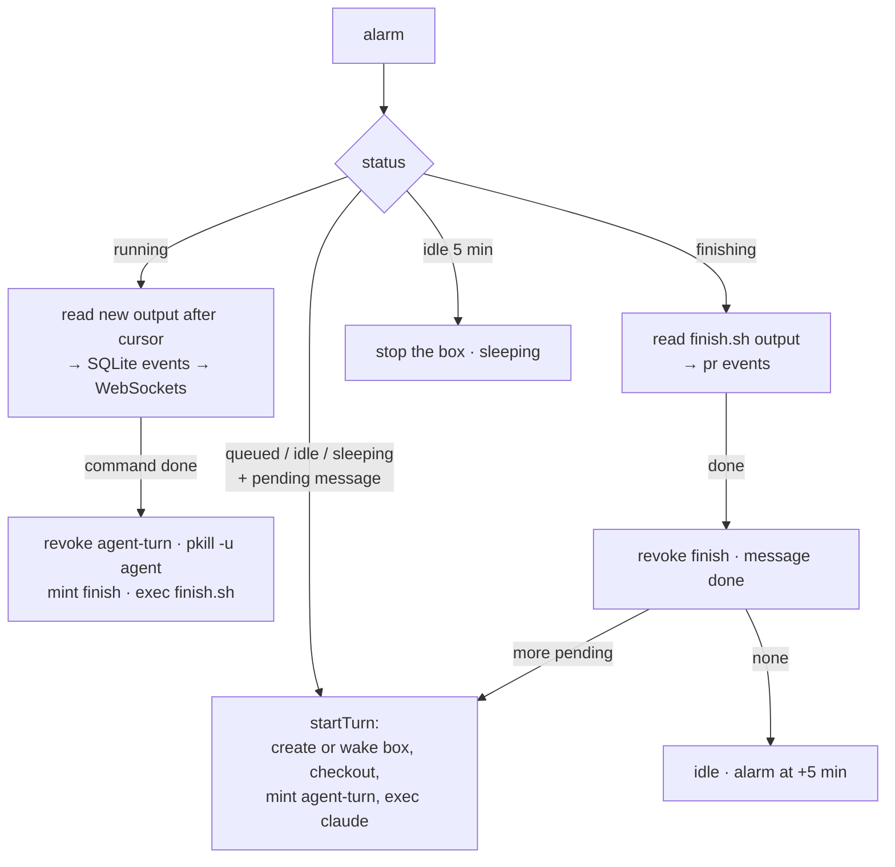

# API Worker and Session Durable Objects

Replaces: `orchestrator/server.mjs` and `orchestrator/runner.mjs` on mini2. Code: [../worker/src/index.js](../worker/src/index.js).

Still plain code, still no AI in it. Instead of one Node process for every session, each session gets its **own Durable Object**: a small single-threaded server with its own SQLite database that Cloudflare keeps alive, or wakes, as needed.

| | |
|---|---|
| API Worker | Stateless. Verifies the JWT, checks the caller owns the session (D1), calls the session's DO over RPC |
| Session DO | One per session, `idFromName(sessionId)`. Holds messages, turns and events; drives the box; streams to clients |
| D1 `agentbox` | `sessions_index`, so `agentbox ls` can list sessions across DOs |
| Vars | `BOXD_URL`, `INFISICAL_URL`, `DEFAULT_REPO`, `PROXY_ADDR=av-relay:17323`, `AGENT_BUNDLE=agent-turn`, `FINISH_BUNDLE=finish`, `IDLE_MINUTES=5`, `ALLOWED_LOGINS`, `GITHUB_OAUTH_CLIENT_ID` |
| Secrets | `BOXD_TOKEN`, `INFISICAL_CLIENT_ID`, `INFISICAL_CLIENT_SECRET`, `JWT_SECRET`, `CF_ACCESS_CLIENT_ID`, `CF_ACCESS_CLIENT_SECRET` |

## HTTP API

All endpoints except `/healthz` and `/auth/*` need the agentbox JWT (`Authorization: Bearer`, or `?access_token=` for the WebSocket).

| Method | Path | Does |
|---|---|---|
| `POST` | `/auth/device`, `/auth/token` | GitHub device login |
| `POST` | `/sessions` | `{prompt}` start a session in `jakehulberg2/infisical2` |
| `POST` | `/sessions/:id/messages` | `{prompt}` follow-up: queued if running, instant if idle, wakes the box if sleeping |
| `GET` | `/sessions` | your last 50 (D1) |
| `GET` | `/sessions/:id` | one session (DO) |
| `GET` | `/sessions/:id/stream?after=<seq>` | WebSocket: replay, then live |
| `POST` | `/sessions/:id/cancel` | kill the command, revoke grants, delete the box |

## The alarm is the engine

The DO never waits on a long call. Every step runs in `alarm()`, which re-arms itself every second while a turn is active:

| Mechanism | What it does |
|---|---|
| `turns.log_next` | Cursor into the command's output on the droplet. Every read starts from it, so a re-read after an eviction never duplicates or loses a line |
| Output on disk | boxd writes each command's output to a file on the droplet, so the DO can read it any time, from any offset |
| Turn timeout | 30 min: the DO kills the command and fails the turn |
| Grant TTL | 45 min (`agent-turn`) and 5 min (`finish`) on Agent Vault's side, so a lost revoke still closes |
| Errors | A failed step fails that turn only: grants revoked, message marked failed, session back to idle for a retry |
| Full droplet | boxd returns 429; the DO puts the message back and retries every 15 s |

The sandbox never talks to the control plane. The DO pulls output; the box only prints to stdout. A compromised box has no write path into session state.

## Streaming

Clients connect with the WebSocket hibernation API (`ctx.acceptWebSocket`). On connect the DO replays events after `?after=<seq>` from SQLite, then every new event is sent to `ctx.getWebSockets()`. When the session settles (idle, sleeping, failed, cancelled) with nothing queued, the DO closes the sockets.
