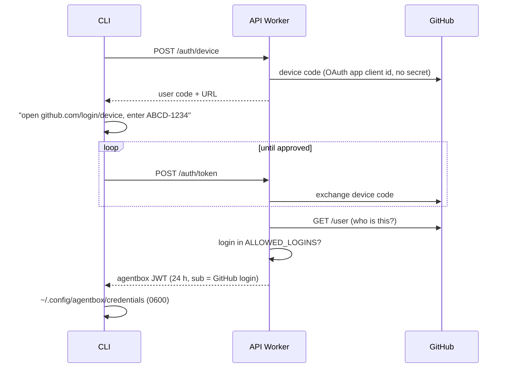

# CLI

Replaces: `agentbox/bin/agentbox` and the shared `ORCH_API_TOKEN`. Code: [../cli/bin/agentbox](../cli/bin/agentbox).

Same thin client as agentbox (no logic, no dependencies, same output), with two changes: every user logs in as themselves, and events stream over a WebSocket to the session's Durable Object.

## Install and log in

```bash
npm i -g ./cloud/cli        # or from git / a private registry once published
agentbox login                         # GitHub device flow
agentbox run "add a test for one untested function"
```



| | |
|---|---|
| Worker URL | `https://agentbox-api.example.workers.dev` (override with `AGENTBOX_URL`) |
| Who's allowed | `ALLOWED_LOGINS` in [../worker/wrangler.toml](../worker/wrangler.toml) |
| What the CLI holds | Only the agentbox JWT. The GitHub token is used once to read the login, then dropped |
| Expiry | 24 h, then `agentbox login` again |
| Repo | `jakehulberg2/infisical2`, the one repo with an image on the droplet |

## Commands

| Command | Calls |
|---|---|
| `agentbox login` / `logout` | `/auth/device`, `/auth/token` |
| `agentbox run ["task"]` | `POST /sessions`, then the stream |
| `agentbox attach <id>` | `GET /sessions/:id`, then the stream for new events |
| `agentbox send <id> "msg"` | `POST /sessions/:id/messages` |
| `agentbox ls` | `GET /sessions` (D1, only yours) |
| `agentbox logs <id>` | stream with `after=0` (full replay) |
| `agentbox cancel <id>` | `POST /sessions/:id/cancel` |

The stream is `wss://…/sessions/:id/stream?after=<seq>&access_token=<jwt>` (the token goes in the query because Node's built-in WebSocket can't set headers). The DO replays events after `seq`, sends new ones live, and closes the socket when the session settles, which is when the CLI shows the prompt.
