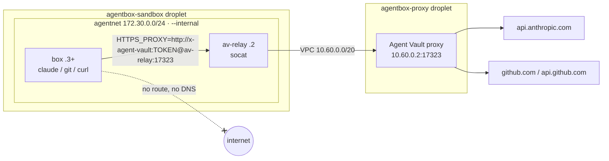

# Networking: the only way out

Replaces: agentnet and av-relay in the Colima VM, and Tailscale between the minis (see [agentbox networking.md](../../local/docs/networking.md)).

The rule is the same as agentbox: **a box has no route anywhere except the Agent Vault proxy.** Anything that ignores `HTTPS_PROXY` just fails.

| Layer | Setting | Verified |
|---|---|---|
| `agentnet` | Docker network with `--internal`: no gateway; Docker's DNS only resolves container names | `curl https://api.anthropic.com` from a box: `Could not resolve host` |
| `av-relay` | `alpine/socat` on `agentnet` (`172.30.0.2`) and the bridge; forwards only `:17323` to `10.60.0.2:17323` | |
| VPC `agentbox` | `10.60.0.0/20`, nyc3; both droplets on it | The relay reaches the proxy privately |
| Proxy port | Bound to `10.60.0.2` only; firewall `agentbox-proxy` allows `17323` only from the VPC | Port 17323 on the public IP: closed |
| Proxy policy | Access bundle hosts only | `example.com` through the proxy: 403 |
| Sandbox droplet inbound | SSH from your IP only; boxd comes in through the Cloudflare Tunnel (outbound connection) | Port 443 on 203.0.113.10: closed |
| TLS | The box trusts the proxy's CA (baked in), so the proxy can decrypt, attach the credential, re-encrypt | |

## Compared to the first design

The first design put the sandboxes on Daytona and the proxy on AWS, so the proxy hop crossed the internet and needed stunnel plus a TLS load balancer. With boxes and proxy on one DigitalOcean VPC, the hop is private, and the relay is the same socat container agentbox used.

## What's still open

| Gap | Fix |
|---|---|
| Box-to-box traffic on `agentnet` | Docker allows it on one network; one network per box or `--icc=false` would close it |
| The session token travels as plain proxy auth inside the VPC | Private network only; add TLS to the relay if the VPC is ever shared |
