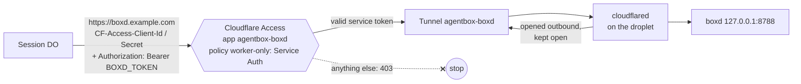
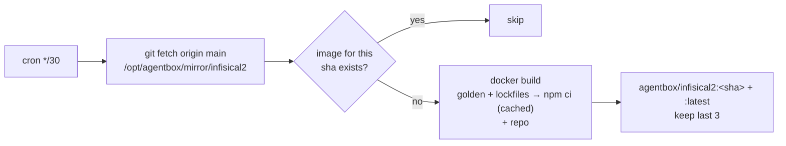
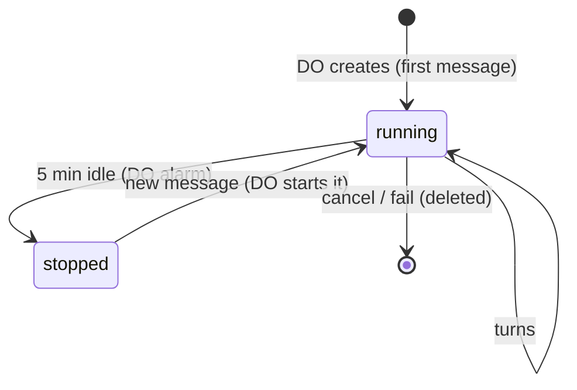

# The sandbox droplet: boxd, boxes and the repo image

Replaces: the Colima VM, the warm pool, the golden image and the git mirrors on mini2 (see [agentbox warm-pool.md](../../local/docs/warm-pool.md)).

| | |
|---|---|
| Droplet | `agentbox-sandbox`, 4 vCPU / 8 GB / 160 GB, Ubuntu 24.04, nyc3 |
| Addresses | public `203.0.113.10`, VPC `10.60.0.3` |
| Firewall `agentbox-sandbox` | in: 22 from your IP only; out: all (the host needs GitHub, Docker Hub and Cloudflare; boxes don't get it) |
| Runs | Docker, `boxd` (systemd), `cloudflared` (container), `av-relay` (container), boxes (containers), image build (cron) |

## boxd: the box API

Code: [../boxd/server.mjs](../boxd/server.mjs). Plain Node, no dependencies, listens on `127.0.0.1:8788` only. Nothing on the droplet listens publicly: the DO reaches boxd through a **Cloudflare Tunnel**.

| Piece | Where | Setting |
|---|---|---|
| Hostname | `boxd.example.com` | Tunnel route (published application) → `http://localhost:8788`, no path |
| Tunnel `agentbox-boxd` | The Cloudflare account that owns example.com | Connector: `cloudflare/cloudflared:2026.9.1` on the droplet, `--network host`, token in `/etc/agentbox/cloudflared.env` |
| Access application `agentbox-boxd` | Same account (Zero Trust Free) | Self-hosted, public DNS destination `boxd.example.com` |
| Policy `worker-only` | On that application | Action **Service Auth**, include **Service Token `agentbox-worker`** (1 year: rotate it) |
| Service token | Client ID + secret | Worker secrets `CF_ACCESS_CLIENT_ID` / `CF_ACCESS_CLIENT_SECRET`, copies in your Infisical keys project |

Two independent locks: Cloudflare Access (service token) at the edge, then `BOXD_TOKEN` in boxd. Verified: without the service token, 403 from Cloudflare; with it, boxd answers; port 443 on the droplet is closed.

| Method | Path | Does |
|---|---|---|
| `POST` | `/boxes` | `{session}` create `agentbox-<session>` on `agentnet`: 2 CPUs, 3 GB, `--cap-drop ALL`, `no-new-privileges` |
| `POST` | `/boxes/:name/start`, `/stop` | wake / sleep; the container's disk is kept while stopped |
| `DELETE` | `/boxes/:name` | destroy |
| `POST` | `/boxes/:name/exec` | `{cmd, env, timeoutSec}` run as `agent` in `/workspace`; returns `{execId}` |
| `GET` | `/execs/:id?after=N` | output lines from N, plus `done` and `exitCode` |
| `POST` | `/execs/:id/kill` | |

At most `MAX_BOXES=3` run at once; a fourth gets 429 and the DO retries. Stopped boxes don't count.

## The repo image

| Layer | Contents |
|---|---|
| `agentbox/golden` | Same as agentbox: `node:22-bookworm-slim`, git, jq, ripgrep, Python, Claude Code, the `do-proxy` CA (SHA256 `92:63:F5:D4:…:CD:AD:1B`), non-root `agent` |
| build tools | `build-essential` (the backend's `pkcs11js` compiles at install) |
| deps | backend + frontend `package.json` / lockfile, then `npm ci`. Cached until a lockfile changes |
| repo | `jakehulberg2/infisical2` at `/workspace`, full history, `origin` = the public GitHub URL |

10.6 GB, but Docker shares it read-only across boxes, so each box only stores what it changes. `backend-go` isn't set up in the image yet. The fork only changes when you sync it with upstream.

## Lifecycle

A box never serves a second session. Stopped boxes are kept until deleted; automatic cleanup after N days is still to do.
