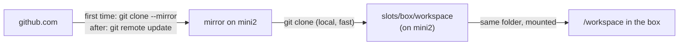

# Git and GitHub: how code gets in and out

The agent never talks to GitHub. The orchestrator does all git and GitHub work from the mini2 host, and the repo reaches the box through a shared folder. The agent just edits files in `/workspace`.

## Folders on mini2

| Path | What |
|---|---|
| `~/agentbox/mirrors/<owner>__<repo>.git` | A bare mirror: the repo's full history, cached. Fetched incrementally each time a session starts |
| `~/agentbox/slots/<box>/workspace` | This box's checkout, mounted into the box as `/workspace` |
| `~/agentbox/sessions/<session>/workspace` | A sleeping session's saved checkout |

## In: from GitHub to `/workspace`

1. **Mirror.** The first session for a repo does a full `git clone --mirror`. Every later one only fetches new commits.
2. **Checkout.** The orchestrator clones from the local mirror into the box's slot folder, points `origin` at GitHub, and creates the branch `agentbox/<session-id>`.
3. **It appears.** The slot folder is already mounted into the box, so the repo shows up in `/workspace` without anything being copied into the container.

## Out: from `/workspace` to a PR

After each turn:

1. **Commit.** Anything the agent left uncommitted is committed (`agentbox <id>: <message>`). The agent may also commit on its own.
2. **Check.** No changes vs. the base branch: nothing to do. Nothing new since the last push: skip (so a question-only follow-up doesn't touch the PR).
3. **Push** the session branch from the host.
4. **PR.** The first push opens a PR through GitHub's API, with the prompt and the agent's summary in the description. Later turns push to the same branch, which updates that PR.

One session, one branch, one PR, however many follow-ups.

## Where the GitHub token is

| | |
|---|---|
| Stored | `GITHUB_TOKEN` in `~/agentbox/.env` on mini2 (a classic PAT on the `jakehulberg2` test account) |
| Used | Only on the host's git command line, as `-c http.extraHeader=Authorization: Basic …`, and in the PR API call |
| Never | Written to `.git/config` (the agent could read that through the mount), passed to the box, or in the Agent Vault bundle |

Keeping git on the host follows Ramp's design: the sandbox gets no GitHub write access, so a prompt-injected agent can't push elsewhere, merge, or delete anything. Ramp also opens PRs with the requesting user's own token, so nobody can approve their own agent's code.

## Planned changes

- **GitHub App instead of a PAT.** The orchestrator signs a JWT with the app's private key (stored in Infisical) and gets a one-hour installation token per session, scoped to the repo. About 15 minutes of GitHub setup and 20 lines of code.
- **Draft PRs.** Open as `draft: true` so an unfinished conversation doesn't look ready for review.
- **Optional: brokered GitHub for the agent.** Add a GitHub service to the Agent Vault bundle so the agent can read issues and PR comments itself, without holding the token (see [agent-vault.md](agent-vault.md)).
