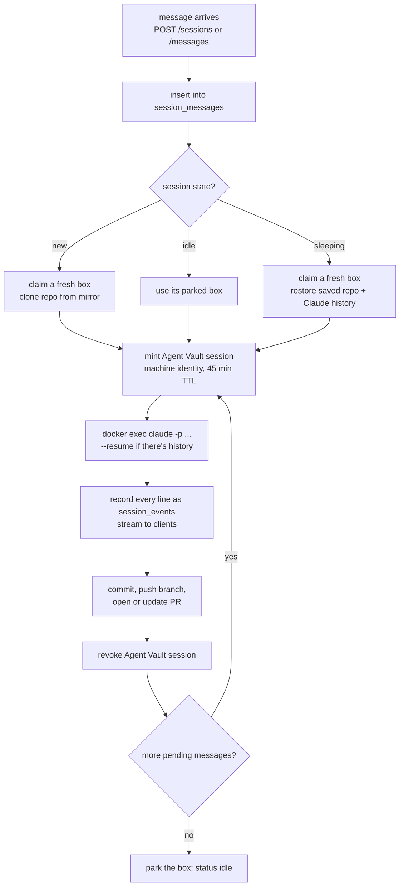

# Orchestrator

The orchestrator is the brain of the platform, except it isn't AI. It's about 600 lines of plain Node code on mini2 that runs the same steps for every message: claim a box, get the repo in, mint credentials, start Claude, record everything, push, clean up. All the judgment happens inside the agent. The orchestrator only coordinates.

It plays the role of Ramp's API layer (their Cloudflare Worker plus Durable Objects).

| | |
|---|---|
| Runs on | mini2 host (macOS), not in Docker, because it drives Docker and git on the host |
| Listens on | `0.0.0.0:8787` (reachable over Tailscale at `100.124.121.114:8787`) |
| Process | tmux session `agentbox`, under `bin/run-orchestrator`, which restarts it if it crashes |
| Code | `orchestrator/` in this repo, synced to `~/agentbox/orchestrator/` on mini2 |
| Dependencies | none (Node 25 built-ins: `node:http`, `node:sqlite`, `node:child_process`) |
| Config | `~/agentbox/.env` |
| Logs | `~/agentbox/orchestrator.log`, or `tmux attach -t agentbox` |

## Files

| File | Job |
|---|---|
| `server.mjs` | HTTP API and SSE streaming; boots recovery, refill and the timers |
| `runner.mjs` | Sessions and turns: scheduling, running Claude, parking, sleeping, cancelling, recovery |
| `pool.mjs` | Boxes: create, claim, park, save and restore state, destroy, reconcile |
| `agentvault.mjs` | Infisical machine identity login; mint and revoke Agent Vault sessions |
| `git.mjs` | Host-side git: mirrors, checkout, commit, push, open PR |
| `db.mjs` | SQLite schema and helpers (see [sqlite.md](sqlite.md)) |
| `config.mjs` | Reads `.env` and defaults |

## What it does for one message



## The loops that run in the background

| Every | What |
|---|---|
| 5 s | `refill()`: keep 3 fresh boxes, never more than 6 total. `schedule()`: start anything that's waiting |
| 30 s | `sleepExpired()`: sessions parked for 15 min get their state saved and their box destroyed |
| on boot | `reconcile()` + `recover()`: remove unknown containers, fail mid-turn sessions and revoke their Agent Vault sessions, put parked sessions to sleep, refill the pool |

## HTTP API

All endpoints except `/healthz` need `Authorization: Bearer $ORCH_API_TOKEN`.

| Method | Path | Does |
|---|---|---|
| `POST` | `/sessions` | `{repo, prompt, baseBranch?, requestedBy?, source?}` start a session |
| `POST` | `/sessions/:id/messages` | `{prompt, author?}` follow-up: queued if running, instant if idle, restored if sleeping |
| `GET` | `/sessions` | last 50 sessions |
| `GET` | `/sessions/:id` | one session |
| `GET` | `/sessions/:id/events?after=<seq>` | SSE: replay then live, closes when the session settles |
| `POST` | `/sessions/:id/cancel` | cancel |
| `GET` | `/pool` | boxes and their state |
| `GET` | `/healthz` | liveness |

## What it holds

| Secret | Why |
|---|---|
| Infisical machine identity (`INFISICAL_CLIENT_ID` / `SECRET`) | To mint and revoke Agent Vault sessions |
| `GITHUB_TOKEN` | To clone, push and open PRs from the host |
| `ORCH_API_TOKEN` | To authenticate clients |

All three are in `~/agentbox/.env` (mode 600). That's the known weak spot: see the "Come back to" item in [../ARCHITECTURE.md](../ARCHITECTURE.md). The plan is a GitHub App for per-session tokens, with the rest fetched from Infisical at startup.

## Settings (`~/agentbox/.env`)

| Var | Default | |
|---|---|---|
| `POOL_SIZE` | 3 | fresh boxes kept warm |
| `MAX_BOXES` | 6 | fresh + busy + parked |
| `IDLE_TIMEOUT_MIN` | 15 | how long a finished session keeps its box |
| `SESSION_TIMEOUT_MIN` | 30 | max length of one turn |
| `MAX_TURNS` | 40 | Claude's step limit per turn |
| `AV_SESSION_TTL` | 45m | Agent Vault session lifetime (revoked earlier, at turn end) |
| `BOX_CPUS` / `BOX_MEMORY` | 1 / 1536m | per box |
| `INFISICAL_URL` | `http://100.127.68.84:8080` | mini3 over Tailscale |
| `AV_PROXY_ADDR` | `av-relay:17323` | the proxy as seen from inside a box |

## Operating it

```bash
ssh mini2
tmux attach -t agentbox            # watch it (ctrl-b d to leave)
tail -f ~/agentbox/orchestrator.log
# restart (parked sessions are put to sleep safely, mid-turn ones are failed)
tmux kill-session -t agentbox; tmux new-session -d -s agentbox ~/agentbox/bin/run-orchestrator
```
