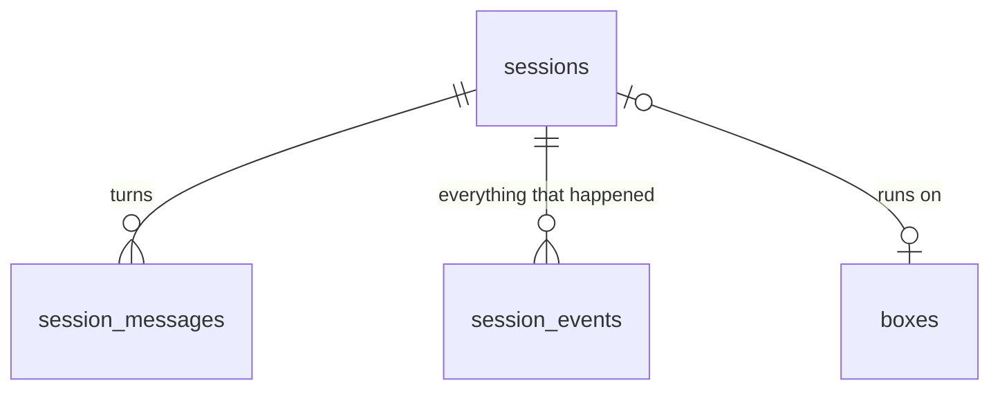

# SQLite: agentbox's memory

Everything agentbox knows about sessions, turns, events and boxes lives in one SQLite file:

```
mini2: ~/agentbox/state/agentbox.db     (about 320 KB after a dozen sessions)
```

SQLite is a database that is just a file. There is no database server to run. The orchestrator opens it with Node's built-in `node:sqlite` (no npm packages) in WAL mode, which lets reads and writes happen at the same time.

## Who writes and who reads

| | Who | How |
|---|---|---|
| **Writes** | Only the orchestrator (`orchestrator/db.mjs`, `runner.mjs`, `pool.mjs`) | Direct SQL. Every state change goes through `updateSession()` or `addEvent()` |
| **Reads** | The orchestrator itself (scheduler, pool, recovery), and every client through the HTTP API | `GET /sessions`, `GET /sessions/:id`, `GET /sessions/:id/events` (SSE), `GET /pool` |
| **Never** | The boxes and the agent | A box has no access to the database. It only prints to stdout, and the orchestrator records what it prints |

This is the Ramp pattern: the sandbox does the work, and a service outside it keeps the record. Ramp keeps one SQLite database per session inside a Cloudflare Durable Object. agentbox keeps one file for all sessions, which is simpler but only works on one machine.

## The four tables



### `sessions`: one row per conversation

| Column | Example | Set when |
|---|---|---|
| `id` | `s-64102cee` | Created |
| `status` | `queued` → `starting` → `running` → `pushing` → `idle` → `sleeping` (or `failed` / `cancelled`) | Every transition |
| `prompt` | the first message | Created |
| `repo`, `base_branch`, `branch` | `jakehulberg2/demo-app`, `main`, `agentbox/s-64102cee` | Created / first checkout |
| `requested_by`, `source` | `jakehulberg`, `cli` | Created |
| `box_id` | `box-a8d15d` while it has a box, empty when sleeping | Claim / park / sleep |
| `av_session_id` | the latest Agent Vault session (`9766e050…`) | Every turn |
| `claude_session_id` | Claude Code's own conversation id (`fb2f5446…`) | First event of each turn |
| `cost_usd`, `num_turns` | `0.111`, `8` | End of each turn |
| `pr_url` | `https://github.com/jakehulberg2/demo-app/pull/38` | First push |
| `error` | `orchestrator restarted mid-session` | On failure |
| `created_at`, `started_at`, `finished_at` | ISO timestamps | |

### `session_messages`: one row per turn

Every message you send, the first task and each follow-up, becomes a row here before anything runs. The scheduler reads this table to decide what to run next.

| id | session_id | prompt | author | status |
|---|---|---|---|---|
| 12 | s-64102cee | do a quick security review of the CSV export... | jakehulberg | done |
| 13 | s-64102cee | explain this to me in 5 lines like I'm a PM... | jakehulberg | done |

`status` is `pending` → `running` → `done` (or `failed`). A message sent while a turn is running just waits as `pending`, which is how follow-ups queue.

### `session_events`: everything that happened, in order

An append-only log. Each row has a global sequence number (`seq`), a `kind` and a JSON `data` blob. Nothing is ever updated or deleted.

| kind | Written by | What's in it | Count so far |
|---|---|---|---|
| `status` | `updateSession()` whenever status changes | `{"status":"running"}` | 86 |
| `agent` | The runner, one row per line Claude Code prints (`--output-format stream-json`) | The model's messages, every **tool call** (name + input) and every **tool result** (output) | 122 |
| `result` | The runner, Claude's last line of a turn | Final answer, steps, cumulative cost, duration | 16 |
| `message` | `sendMessage()` | A follow-up you sent | 6 |
| `log` | The runner, for orchestrator actions, tagged for the CLI | `tag: box` (which box, IP, branch), `tag: creds` (Agent Vault session minted or revoked), `tag: parked`, `tag: nochanges`, plus Claude's stderr | 100 |
| `pr` | The runner after pushing | Diff stat, PR URL, or the diff itself if there's no GitHub token | 16 |
| `error` | Timeouts, sleep failures | `{"msg":"timed out after 30 min"}` | |

A real turn, abridged:

```
155 status  {"status":"queued"}
156 status  {"status":"starting"}
157 log     {"tag":"box","mode":"new","box":"box-1f7a2a","ip":"172.30.0.6","branch":"agentbox/s-92af8f80"}
158 log     {"tag":"creds","action":"minted","turn":1,"avSession":"f5a77e0b-…","bundle":"agentbox"}
159 status  {"status":"running"}
160 agent   {"type":"system","subtype":"init","session_id":"7ace2e2b-…","tools":["Bash","Edit",…]}
161 agent   {"type":"assistant", … "tool_use","name":"Bash","input":{"command":"cat BUGS.md"}}
162 agent   {"type":"user", … "tool_result","content":"# Demo App - Intentional Bugs…"}
163 agent   {"type":"assistant", … "text":"No test setup exists. Let me look at the code."}
166 agent   {"type":"assistant", … "tool_use","name":"Write","input":{"file_path":"/workspace/src/utils/search.ts",…}}
…
    result  {"num_turns":6,"total_cost_usd":0.077,"result":"Change: in src/utils/search.ts I added…"}
    pr      {"url":"https://github.com/jakehulberg2/demo-app/pull/37"}
    log     {"tag":"creds","action":"revoked","avSession":"f5a77e0b-…"}
    status  {"status":"idle"}
```

What it does **not** contain: the raw HTTP calls to Anthropic. Those go through the Agent Vault proxy and aren't logged here. What's here is what Claude Code reports about its own work, which covers every tool call and response, but only because Claude prints them.

### `boxes`: the warm pool

| Column | Example |
|---|---|
| `id`, `container`, `ip` | `box-50a2de`, `agentbox-box-50a2de`, `172.30.0.7` |
| `slot_dir` | `~/agentbox/slots/box-50a2de` (mounted into the box) |
| `status` | `warming` → `idle` (fresh) → `busy` → `parked` → `draining` (then the row is deleted) |
| `session_id` | the session using it, if any |
| `created_at`, `claimed_at`, `parked_at` | `parked_at` drives the 15-minute idle timeout |

Claiming a box is one SQL statement, so two sessions can never get the same box:

```sql
UPDATE boxes SET status = 'busy', session_id = ?, claimed_at = ?
WHERE id = (SELECT id FROM boxes WHERE status = 'idle' ORDER BY created_at LIMIT 1)
RETURNING *;
```

## Why it's useful

| Need | How SQLite answers it |
|---|---|
| **Live progress** in the CLI or Slack | Every event row is also pushed to anyone following `/events` over SSE. Clients that reconnect pass `?after=<seq>` and get exactly what they missed |
| **Picking a session back up** | `claude_session_id` + `session_messages` let a follow-up run `claude --resume` hours later, even after the box is gone |
| **Audit: what did the agent do?** | Every tool call and its output, with timestamps, per session |
| **Audit: what could it access?** | `av_session_id` joins to Infisical's Agent Vault session list and audit log (bundle, actor, mint and revoke times) |
| **Cost and usage** | `cost_usd` and `num_turns` per session, `requested_by` per person |
| **Surviving crashes** | On boot, the orchestrator reads SQLite to find mid-turn sessions (marks them failed, revokes their Agent Vault sessions) and parked boxes (puts them to sleep with state saved) |
| **Scheduling** | Pending rows in `session_messages` and idle rows in `boxes` are the whole scheduler state |

## Poking at it

```bash
ssh mini2
sqlite3 -header -column ~/agentbox/state/agentbox.db

select id, status, round(cost_usd,3) cost, num_turns, pr_url from sessions order by created_at desc limit 5;
select kind, count(*) from session_events group by kind;
-- every tool call in a session
select json_extract(data,'$.message.content[0].name') tool,
       json_extract(data,'$.message.content[0].input.command') cmd
from session_events where session_id='s-64102cee' and kind='agent'
  and json_extract(data,'$.message.content[0].type')='tool_use';
```

## In production

Swap the single file for **Cloudflare Durable Objects**, one per session, each with its own SQLite, as Ramp does. Same tables, but a busy session can't slow the others down, state is reachable from anywhere, and multiple clients (web, Slack, CLI) connect straight to the session's object over WebSockets.
