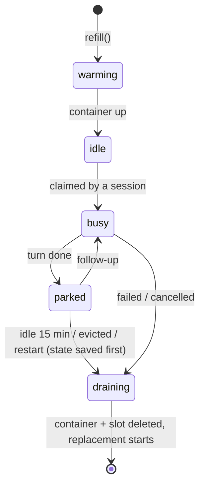

# Warm pool, boxes and the golden image

A **box** is a sandbox where one session's agent runs: a Docker container on mini2. The **warm pool** is a few boxes started ahead of time so a new session doesn't wait for one to boot. Every box is started from the same **golden image**.

This is the same idea as Stripe's pre-warmed devboxes and Slack's pool of EC2 dev environments, on one Mac mini.

## The golden image: `agentbox/golden:latest`

Built from [`../golden/Dockerfile`](../golden/Dockerfile), about 940 MB.

| Layer | Contents | Why |
|---|---|---|
| Base | `node:22-bookworm-slim` | Claude Code is a Node app |
| Tools | git, curl, jq, ripgrep, python3, make, procps | What an agent needs to read, run and change code |
| Agent | Claude Code (`@anthropic-ai/claude-code`, 2.1.283 when built) | Pinned at build time so every box runs the same version |
| Trust | The Agent Vault proxy's CA certificate, added to the system store, with `SSL_CERT_FILE`, `NODE_EXTRA_CA_CERTS`, `GIT_SSL_CAINFO` etc. pointing at it | The proxy decrypts HTTPS to attach credentials, so the box has to trust it |
| Behavior | `NODE_USE_ENV_PROXY=1`, `CLAUDE_CODE_DISABLE_NONESSENTIAL_TRAFFIC=1`, `DISABLE_AUTOUPDATER=1`, `IS_SANDBOX=1` | Node's fetch honors `HTTPS_PROXY`; no background noise; allows `--dangerously-skip-permissions` |
| User | `agent` (uid 1001), workdir `/workspace` | Not root |
| Command | `sleep infinity` | The box idles until the orchestrator `docker exec`s into it |

**No secrets.** No API key, no git credential, no token. Those only exist at `docker exec` time, and only as short-lived values.

Rebuild after changing the Dockerfile or the proxy's CA:

```bash
ssh mini2 'cd ~/agentbox/golden && DOCKER_CONTEXT=colima-agentbox docker build -t agentbox/golden:latest .'
# new boxes use it; restart the orchestrator to replace idle ones
```

## A box

```
docker run -d --name agentbox-box-50a2de --network agentnet \
  --cpus 1 --memory 1536m --pids-limit 1024 --cap-drop ALL --security-opt no-new-privileges \
  -v ~/agentbox/slots/box-50a2de/workspace:/workspace \
  -v ~/agentbox/slots/box-50a2de/claude:/home/agent/.claude \
  agentbox/golden:latest
```

| Mount (host → box) | Holds | Why a host folder |
|---|---|---|
| `slots/<box>/workspace` → `/workspace` | The repo | The orchestrator writes the checkout and does git from the host, so git credentials never enter the box |
| `slots/<box>/claude` → `/home/agent/.claude` | Claude Code's conversation history | So it can be saved when the box goes away and restored for `--resume` |

## Lifecycle



**A box never serves a second session.** When a session is done with it, the box is destroyed, its folders deleted, and a new one is built from the golden image. Nothing (files, processes, caches) can leak from one session to the next.

## Sizing

| | |
|---|---|
| Fresh boxes kept warm | 3 (`POOL_SIZE`) |
| Most boxes at once | 6 (`MAX_BOXES`: fresh + busy + parked) |
| Per box | 1 CPU, 1.5 GB |
| When full | A new session puts the longest-idle parked session to sleep to free a slot |
| VM behind it | 6 CPU, 10 GB (see [networking.md](networking.md)) |

An idle box costs almost nothing (it's running `sleep`). The memory limit only matters while Claude is working.

## Sleeping sessions

When a parked session goes to sleep, its two folders are copied to `~/agentbox/sessions/<session-id>/` and the box is destroyed. A follow-up claims a fresh box and copies them back in, then runs `claude --resume`. Claude picks up with its full memory of the conversation, in the same `/workspace` path.

## What's missing vs. Ramp

Ramp snapshots the whole sandbox every 30 minutes with dependencies installed and services built, so sessions start ready to run tests. Our boxes start with the tools but a bare checkout: an agent that needs `npm install` pays for it each session.
